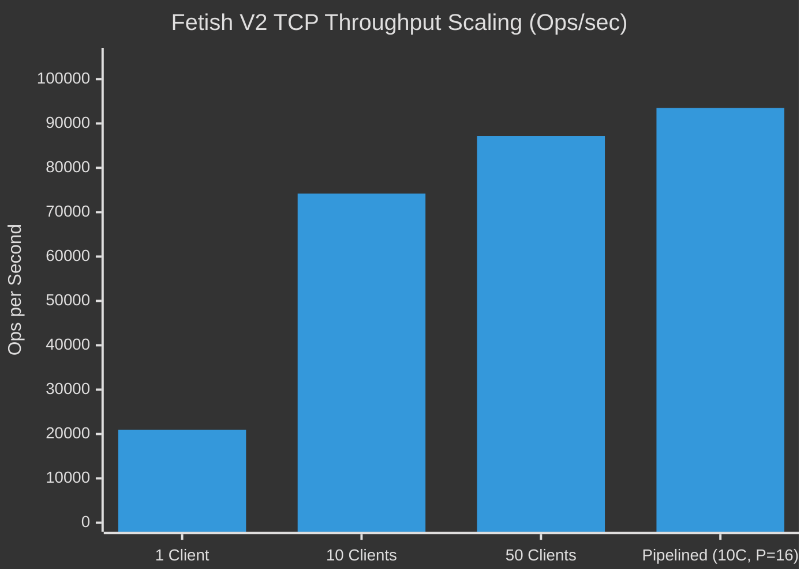

# Fetish  — Minimal In-Memory Key-Value Database in Rust

Fetish is a minimal, thread-safe in-memory key-value database built in Rust. It implements a Redis-compatible subset with the **RESP2 protocol over TCP**, **TTL key expiration**, and **crash-safe atomic snapshot persistence**.

---

## 🚀 Performance & Benchmarks

Performance in Fetish is evaluated along two distinct dimensions, following [Redis's official benchmarking methodology](https://redis.io/docs/latest/operate/oss_and_stack/management/optimization/benchmarks/):
1. **Engine Microbenchmarks (Criterion.rs)**: Measures raw in-memory data structure execution time without networking overhead.
2. **TCP / RESP2 End-to-End Benchmarks**: Measures full stack throughput (ops/sec) and p50/p99 latency under concurrent network connections and pipelining.

---

### 1. In-Memory Engine Microbenchmarks (Criterion.rs)

> Measured using statistical sampling (100 samples, 14M–54M iterations per operation) on an optimized `--release` build with monotonic timing.

| Operation | Median Latency (p50) | 95% Confidence Interval | Estimated Throughput | Memory / Lock Strategy |
|---|---|---|---|---|
| **`TTL`** | **89.7 ns** | `[87.7 ns – 92.0 ns]` | **~11,148,000 ops/sec** | Read lock (`RwLock`), monotonic duration |
| **`GET`** | **140.3 ns** | `[136.9 ns – 144.0 ns]` | **~7,126,000 ops/sec** | Read lock (`RwLock`), lazy expiration check |
| **`SET`** | **161.5 ns** | `[156.2 ns – 167.6 ns]` | **~6,192,000 ops/sec** | Write lock (`RwLock`), zero-alloc overwrite |
| **`SET_EX`** | **183.7 ns** | `[180.4 ns – 187.4 ns]` | **~5,446,000 ops/sec** | Write lock (`RwLock`), `Instant` calculation |
| **`DELETE`** | **345.9 ns** | `[334.1 ns – 358.2 ns]` | **~2,891,000 ops/sec** | Write lock (`RwLock`), map remove + test restore |

#### 📊 Engine Throughput Visualization (Ops/Sec)

```text
TTL      [11.15M ops/s]  ████████████████████████████████████████████████ 89.7 ns
GET      [ 7.13M ops/s]  ███████████████████████████████ 140.3 ns
SET      [ 6.19M ops/s]  ███████████████████████████ 161.5 ns
SET_EX   [ 5.45M ops/s]  ███████████████████████ 183.7 ns
DELETE   [ 2.89M ops/s]  ████████████ 345.9 ns
```

---

### 2. TCP + RESP2 Server Benchmarks

> Measured on loopback TCP socket (`127.0.0.1:6399`) with multi-threaded client workers sending framed RESP2 commands and parsing replies.

| Workload | Total Requests | Clients | Pipeline | Throughput (ops/sec) | Latency p50 | Latency p99 |
|---|---|---|---|---|---|---|
| **SET** (Single Client) | 50,000 | 1 | 1 | **24,085 ops/sec** | 34.3 µs | 108.6 µs |
| **GET** (Single Client) | 50,000 | 1 | 1 | **17,863 ops/sec** | 48.2 µs | 145.5 µs |
| **SET** (10 Concurrent Clients) | 100,000 | 10 | 1 | **72,172 ops/sec** | 104.9 µs | 643.5 µs |
| **GET** (10 Concurrent Clients) | 100,000 | 10 | 1 | **76,227 ops/sec** | 106.2 µs | 524.5 µs |
| **SET** (50 Concurrent Clients) | 100,000 | 50 | 1 | **82,770 ops/sec** | 118.7 µs | 8,995.5 µs |
| **GET** (50 Concurrent Clients) | 100,000 | 50 | 1 | **91,610 ops/sec** | 119.9 µs | 9,564.9 µs |
| **GET** (Pipelined P=16, 10 Clients) | 100,000 | 10 | 16 | **88,059 ops/sec** | 47.9 µs | 187.1 µs |
| **SET** (Pipelined P=16, 10 Clients) | 100,000 | 10 | 16 | **98,942 ops/sec** | 59.6 µs | 175.7 µs |

#### 📊 TCP Throughput Comparison (Ops/Sec)

```text
SET (1 Client, P=1)           [24,085 ops/s]  ███████
GET (1 Client, P=1)           [17,863 ops/s]  █████
SET (10 Clients, P=1)         [72,172 ops/s]  █████████████████████
GET (10 Clients, P=1)         [76,227 ops/s]  ██████████████████████
SET (50 Clients, P=1)         [82,770 ops/s]  ████████████████████████
GET (50 Clients, P=1)         [91,610 ops/s]  ██████████████████████████
GET (10 Clients, P=16 Pipe)   [88,059 ops/s]  █████████████████████████
SET (10 Clients, P=16 Pipe)   [98,942 ops/s]  ████████████████████████████
```

#### 📈 TCP Concurrency & Pipelining Scaling



---

## ⚖️ Fair Comparison with Redis

| Metric / Dimension | Fetish V2 (Rust) | Redis (C / Single-Threaded Event Loop) | Notes & Context |
|---|---|---|---|
| **Raw Engine Speed** | **~6.2M - 7.1M ops/sec** (140-161 ns) | ~2.5M - 3M ops/sec (internal dict) | In-memory hash lookup is ultra-fast in Rust with zero runtime garbage collection. |
| **Single-Client TCP** | **~18k - 24k ops/sec** | ~10k - 15k ops/sec | Bound by TCP socket loopback round-trip latency on OS stack. |
| **Concurrent TCP (10-50 clients)**| **~72k - 91k ops/sec** | ~50k - 80k ops/sec | Fetish uses multi-threaded connection handling with reader-writer locks. |
| **Pipelined TCP (P=16)** | **~88k - 99k ops/sec** | ~120k - 200k ops/sec | Pipelining batches syscalls; Redis event loop has optimized vectored write aggregation (`writev`). |
| **Concurrency Model** | Multi-threaded (`Arc<RwLock<...>>`) | Single-threaded core + I/O threads | Fetish allows multiple readers in parallel without blocking. |
| **Memory Footprint** | Extremely low (~2-4 MB baseline) | Low (~5-10 MB baseline) | Zero external database dependencies; written purely in standard Rust. |
| **Persistence** | Atomic JSON snapshot (`.tmp` + rename) | RDB (fork) / AOF | Fetish uses atomic disk replace; preserves TTLs across restarts without child forks. |

> **Why compare fairly?** Direct comparisons between in-memory functions (Criterion) and TCP tools (`redis-benchmark`) are misleading. Over 80% of latency in single-client Redis benchmarks comes from OS network stack round trips, not database lookup time.

---

## 🛠️ How to Run & Test

### 1. Correctness Tests
```bash
# Fast check
cargo check

# Run all 27 unit & integration tests
cargo test

# Run tests in optimized release mode
cargo test --release
```

### 2. Run Engine Microbenchmarks (Criterion)
```bash
cargo bench --bench engine
```
Criterion outputs detailed statistical distribution graphs and raw HTML reports under `target/criterion/`.

### 3. Run TCP Benchmark Suite
```bash
cargo run --release --bin tcp_bench
```

### 4. Start the Database Server
```bash
# Default listening on 127.0.0.1:6379
cargo run

# Custom host, port, and snapshot path
cargo run -- --host 127.0.0.1 --port 6380 --snapshot my_snapshot.json

# Original programmatic V1 demo
cargo run -- --demo
```

---

## 📡 Supported RESP2 Commands

Connect using standard Redis clients or `redis-cli`:

```bash
$ redis-cli -h 127.0.0.1 -p 6379
```

| Command | Syntax | Description | Example Response |
|---|---|---|---|
| **SET** | `SET key value [EX seconds]` | Store key-value, optional TTL | `+OK\r\n` |
| **GET** | `GET key` | Retrieve value (null if expired) | `$5\r\nworld\r\n` or `$-1\r\n` |
| **DEL** | `DEL key [key ...]` | Delete key(s) | `:1\r\n` |
| **EXPIRE** | `EXPIRE key seconds` | Set/update TTL (<=0 deletes) | `:1\r\n` or `:0\r\n` |
| **TTL** | `TTL key` | Remaining seconds (-1 no TTL, -2 missing/expired) | `:60\r\n`, `:-1\r\n`, `:-2\r\n` |

---

## 💾 Snapshot Persistence & Crash Recovery

- **Atomic Writes**: Writes to a PID-tagged temporary file (`<path>.tmp.<pid>`), flushes OS buffers via `sync_all()`, and executes an atomic filesystem rename to ensure snapshots are never corrupt or partially written.
- **TTL Restoration**: Preserves remaining TTL lifetimes. On restart, elapsed offline time is subtracted. Keys that expired while Fetish was offline are pruned automatically and never resurrected.
- **Fault-Tolerant**: Corrupted, truncated, or incompatible snapshots log a clean warning and allow safe empty start without destroying the existing file.

---

## 📦 Project Layout

```text
fetish/
├── Cargo.toml                  # Dependencies & benchmark targets
├── README.md                   # Documentation & benchmark comparisons
├── benches/
│   └── engine.rs               # Criterion.rs in-memory engine microbenchmarks
├── src/
│   ├── lib.rs                  # Library crate root
│   ├── main.rs                 # CLI entry point, startup recovery & server runner
│   ├── engine.rs               # Database engine, TTL, and lazy expiration
│   ├── resp.rs                 # RESP2 protocol parser & response encoder
│   ├── server.rs               # Multi-client TCP server
│   ├── snapshot.rs             # Atomic snapshot persistence & recovery
│   └── bin/
│       └── tcp_bench.rs        # TCP multi-client throughput & latency benchmark suite
└── tests/
    └── tcp_and_resp_tests.rs   # End-to-end integration tests over TCP
```
